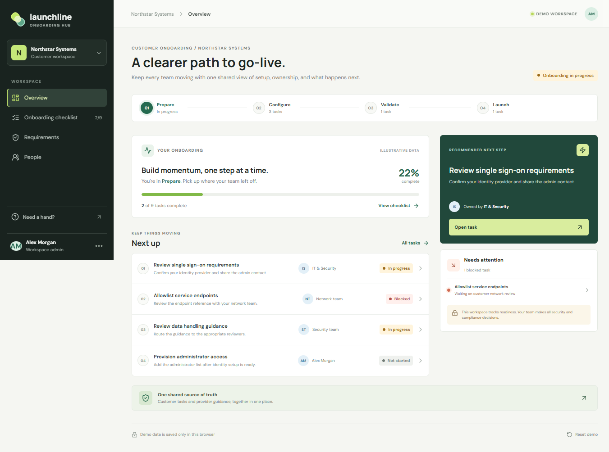
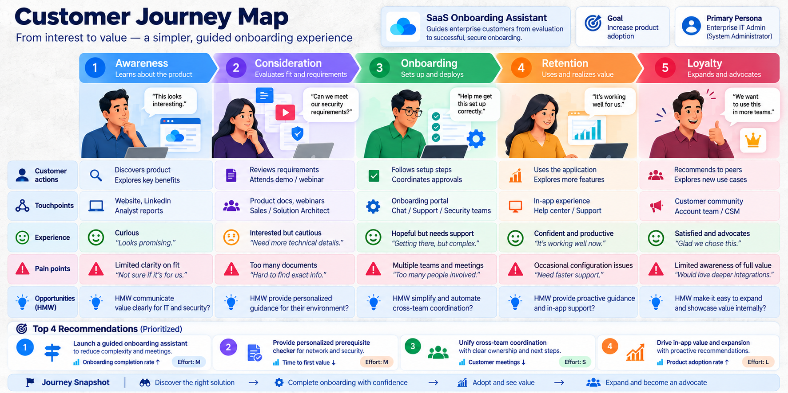
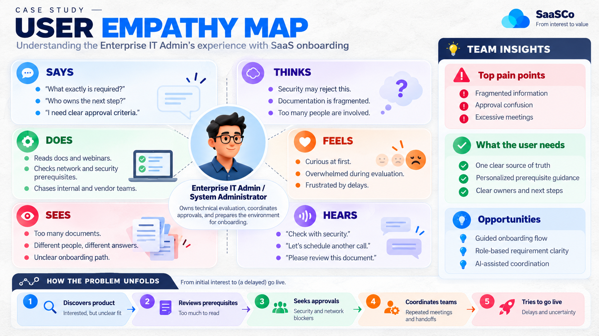

# Launchline

**Guided onboarding for enterprise SaaS.** A shared workspace for setup tasks, ownership, blockers, requirements, and next steps.

<p align="center">
	
	
	
	
</p>



## The Problem

Enterprise SaaS onboarding often spans documents, demos, technical discussions, and approvals handled by several internal and provider teams. Customers may not know which prerequisites apply, who owns the next step, or what is blocking progress. Repeated conversations and inconsistent guidance can delay adoption.

## The Proposed Experience

Launchline is designed around a shared, trackable onboarding workspace for the Enterprise IT Administrator and provider-side teams.

The working prototype includes:

- A guided onboarding checklist with clear task status and ownership.
- A progress overview that shows what is complete, outstanding, or blocked.
- Visible dependencies and actionable next steps.
- Relevant prerequisite guidance, clearly separated from customer approval decisions.
- Responsive layouts and accessible interaction patterns.

## Product Scope

**MVP:** Guided onboarding checklist and transparent progress view, demonstrated with realistic sample data.

**Later priorities:** Personalized prerequisite checking; then, subject to validation, an AI onboarding assistant and stakeholder coordination.

**Out of scope:** Creating onboarding videos, replacing Sales/CSM/Security teams, or automating customer security, network, compliance, or infrastructure approvals.

## Project Documentation

- [PRD](PRD.md): Product requirements, users, scope, acceptance criteria, and success measures.
- [Context](context.md): Product and implementation context for VS Code and future contributors.
- [Build plan](plan.md): Phased implementation and validation plan.

<details>
<summary>Product discovery references</summary>

The supplied journey and empathy maps informed the product framing. They are discovery artifacts, not screenshots of the implemented interface.




</details>

## Features

- Overview with completion progress, onboarding stages, recommended next step, and blockers.
- Guided checklist grouped by stage, with filters and task search.
- Task detail panel with owner, dependency, blocker, next action, and editable demo status.
- Requirements view that connects illustrative prerequisite guidance to related work.
- People view separating customer and provider responsibilities.
- Responsive layout; demo task changes persist in browser local storage.

All names, tasks, requirement details, and status changes are illustrative. This prototype has no backend, authentication, notifications, or production customer data. It does not approve security, network, or compliance requirements.

## Tech Stack

- React 19 and TypeScript
- Vite
- Lucide icons
- CSS with responsive layouts and reduced-motion support

## Run Locally

Requirements: Node.js 20.19+ or 22.12+ and npm.

```bash
npm install
npm run dev
```

Open the local URL printed by Vite. To verify the production bundle:

```bash
npm run build
npm run preview
```

## Success Measures

The product's north-star metric is successful onboarding completion rate. Supporting measures are onboarding completion rate, median onboarding time, customer meetings/touchpoints, and prerequisite-related follow-ups or escalations. Customer Onboarding CSAT is the counter metric and should not decrease.

These are intended product measures, not results claimed by this portfolio prototype. They require defined event instrumentation and real customer data to evaluate.

## Product Guardrails

- The product guides and coordinates; it does not replace human onboarding teams.
- Customer-authorized teams remain responsible for their approval decisions.
- A checklist state must not be presented as proof that an external approval has been granted.
- Any demo data is illustrative and must not include real customer information or credentials.

## Portfolio Updates

This repository is a frontend demo backed by sample data in the browser. Completion, time-to-value, touchpoint reduction, and onboarding CSAT are product success measures from the PRD; this prototype does not measure or claim those outcomes. Add a deployed demo URL here if you publish the app to a hosting provider.
